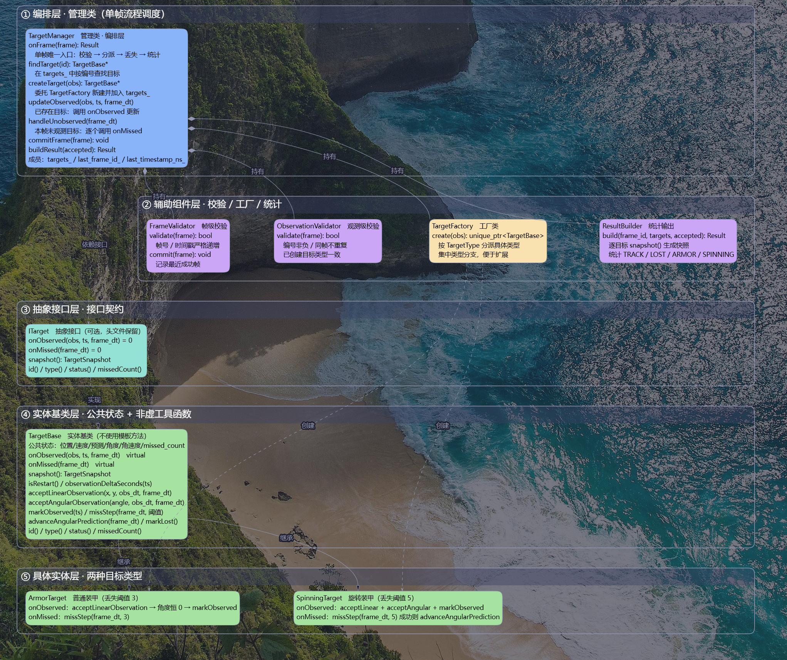
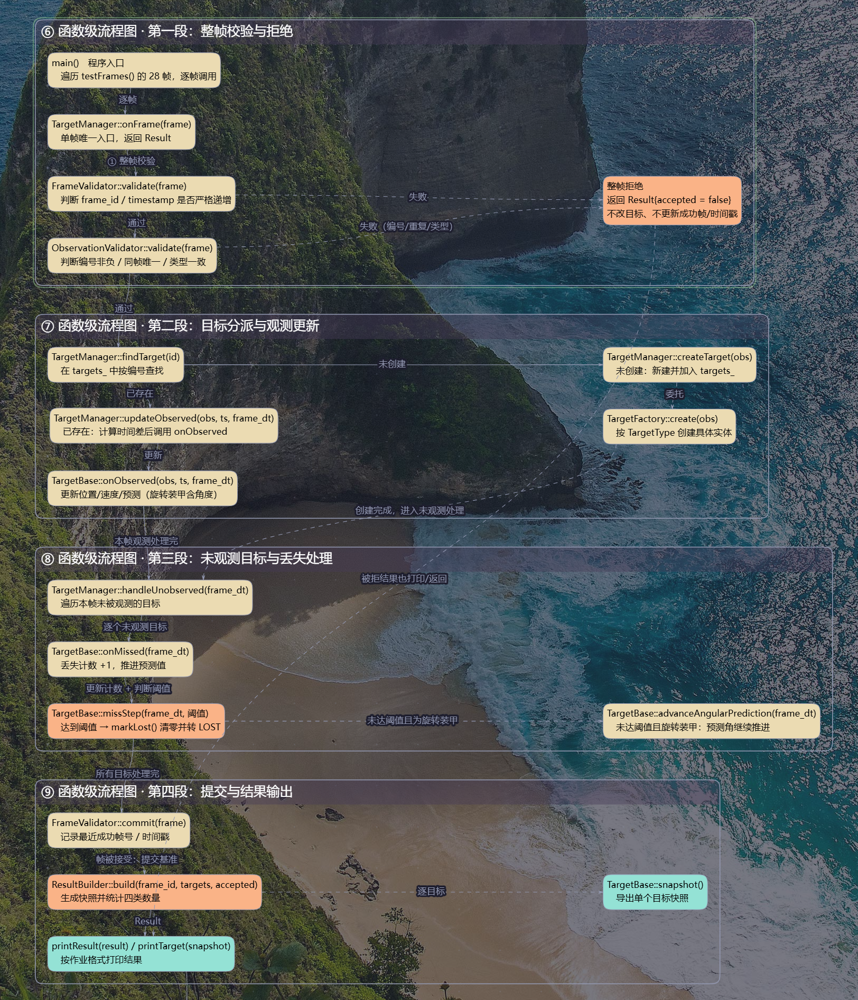

# 第二次作业 · 项目说明

## 0. 基本信息
- 项目地址:[Github](https://github.com/YuHeng-CHi/vision-tracker)
- 姓名:迟钰恒       
- 学号:2026078419
- 完成日期:2026/11/21
- 是否完成全部基础功能:是 

## 1. 类设计&流程图
### 类设计图

## 2. 一帧处理流程
### 1. Manage(负责**帧**级别) 
> 对帧等级的合法性检验，通过接口创建Target对象，更新帧，以及返回帧结果
### 2. Virtual API(纯虚接口)
> 负责注册装甲的类型，以及接受并创建已有的装甲对象。返回类的地址。
### 3. TargetCheck(负责**Target**级别)   
> 对对象的Target级别的合法性检验，计算速度，预测位置，检测对象状态。
### 4. 具体函数流程图

## 3. 附加项

完成情况填写“已完成 / 未完成”。

### 3.1 完成情况

| 附加项 | 是否完成 |
| --- | --- |
| 附加一：`LOST` 目标超时删除 | × |
| 附加二：类型变化时重建目标 | × |
| 附加三：自主学习并使用 static | √ |
| 附加四：自主学习并使用智能指针 | √ |
| 附加五：目标排序 | × |

### 3.2 附加三：静态成员与 static

| 使用位置 | 声明 | 用途 |
| --- | --- | --- |
| `include/targettracker/targetfactory/TargetFactory.hpp`（实现位于 `src/targettracker/targetfactory/TargetFactory.cpp`） | `static std::unique_ptr<TargetBase> create(const rm::Observation &obs);` | 根据观测的 `TargetType` 创建对应目标对象，返回 `unique_ptr<TargetBase>` |
| `include/targettracker/targetfactory/ResultBuilder.hpp`（实现位于 `src/targettracker/targetfactory/ResultBuilder.cpp`） | `static rm::Result build(int frame_id, const std::vector<std::unique_ptr<TargetBase>> &targets, bool accepted);` | 遍历所有目标生成快照并统计 TRACK/LOST、ARMOR/SPINNING，组装 `Result` |

- static成员函数是对类本身的方法，一般不修改对象的状态，可以当作对类进行类进行操作的工具。
- TargetFactory中使用用于创建对象的creat()方法时，不需要先创建TargetFactory对象，而可以直接使用其方法，从而不仅修优化了代码结构的可读性，而且减少了创建对象的开销。
- 同时,还可以让方法属于这个类的层，避免了命名空间的污染。

### 3.3 附加四：智能指针

| 使用位置 | 代码 | 作用 |
| --- | --- | --- |
| `TargetManager` 的目标容器 | `std::vector<std::unique_ptr<TargetBase>> targets_;` | 以多态方式持有所有目标，并负责它们的生命周期 |
| `TargetFactory::create` | 返回 `std::unique_ptr<TargetBase>`；内部使用 `std::make_unique<ArmorTarget>(obs)` / `std::make_unique<SpinningTarget>(obs)` | 工厂创建具体目标，并将所有权交给调用方 |
| `TargetManager::createTarget` | `auto target = TargetFactory::create(obs); targets_.push_back(std::move(target));` | 把工厂返回的所有权移动进目标容器 |
| `ResultBuilder::build` | 参数 `const std::vector<std::unique_ptr<TargetBase>> &targets` | 只借用目标列表生成结果，不参与所有权 |

- 智能指针可以有效的防止new了一块堆内存，忘了delete，逻辑复杂不知道在哪里delete的问题，以及内存无指针指向等问腿，从而有效防止了内存泄漏。
- TargetFactory通过使用unique_ptr获取创建好对象的地址，既保证了地址的唯一所有权，又不用写析构函数将内存delete掉。
## 4. 遇到的问题 / 未完成的部分

- 
- 
